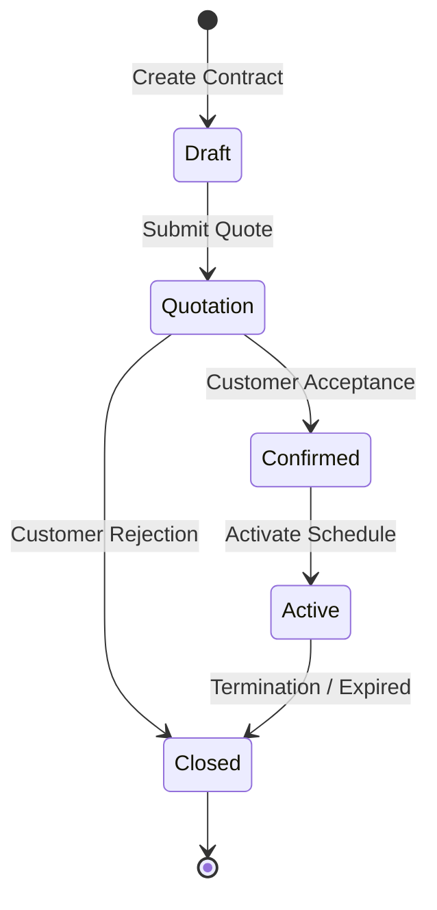

# Cadence Design System — "Quiet Financial Instrument"

A disciplined, editorial design system for recurring-billing operations and contract lifecycle management.

---

## 1. Aesthetic Philosophy

Cadence is styled not like a generic SaaS dashboard with neon gradients or glassmorphism, but as a **high-precision financial instrument** (in the lineage of Stripe, Linear, Ramp, and Mercury). 

- **Restrained & Editorial**: Information-dense yet breathable, using generous whitespace and strict 8px grid alignments.
- **Hairline Precision**: 1px crisp borders (`#E6E5DC` in light mode, `#262624` in dark mode) replace heavy drop-shadows.
- **Single Accent Commitment**: Deep Forest Emerald (`#0D4A38` in light mode, `#15805D` in dark mode). Semantic status colors are desaturated and used sparingly so they do not compete for visual attention.
- **Tabular Numerals**: Every monetary figure, percentage, serial number, and timestamp is rendered in `JetBrains Mono` with `tabular-nums` alignment to prevent visual jitter during animations and scans.

---

## 2. Color Palette & Tokens

### Light Mode (Warm Canvas)
```css
--color-canvas:        #FAFAF7; /* Warm, unbleached paper off-white */
--color-canvas-subtle: #F3F3EC; /* Subtle grouped section backgrounds */
--color-surface:       #FFFFFF; /* Elevated card surface */
--color-surface-hover: #F7F7F2; /* Row / interactive hover state */
--color-border:        #E6E5DC; /* Hairline card & divider border */
--color-border-subtle: #EFEFE8; /* Soft inner grid lines */
--color-ink:           #141413; /* Near-black primary text */
--color-ink-muted:     #6B6A63; /* Secondary supporting labels */
--color-ink-faint:     #9E9C93; /* Tertiary captions, IDs, timestamps */
--color-accent:        #0D4A38; /* Deep Forest Emerald */
--color-accent-tint:   #EBF4F0; /* Soft emerald pill / active nav tint */
```

### True-Dark Mode
```css
--color-canvas:        #0C0C0B; /* Deep carbon black */
--color-canvas-subtle: #121211; /* Grouped container background */
--color-surface:       #171716; /* Card surface */
--color-surface-hover: #1F1F1D; /* Hover highlight */
--color-border:        #262624; /* Hairline border */
--color-ink:           #EDEDEA; /* High contrast reading ink */
--color-ink-muted:     #94938B; /* Secondary muted text */
--color-ink-faint:     #63625C; /* Dimmed hints and captions */
--color-accent:        #15805D; /* Electric forest green */
--color-accent-tint:   #08281D; /* Active background tint */
```

### Semantic Status Colors (Desaturated)
- **Active / Settled / Paid**: Emerald (`bg-emerald-500/10 text-emerald-700 dark:text-emerald-400 border-emerald-500/20`)
- **Quotation / Pending / Warning**: Amber (`bg-amber-500/10 text-amber-700 dark:text-amber-400 border-amber-500/20`)
- **Confirmed**: Sky Blue (`bg-sky-500/10 text-sky-700 dark:text-sky-400 border-sky-500/20`)
- **Overdue / Danger**: Rose/Crimson (`bg-rose-500/10 text-rose-700 dark:text-rose-400 border-rose-500/20`)
- **Draft / Closed**: Neutral (`bg-[var(--color-canvas-subtle)] text-[var(--color-ink-muted)] border-[var(--color-border)]`)

---

## 3. Typography Hierarchy

| Role | Font Family | Example Target |
| :--- | :--- | :--- |
| **Display Headings & Key Numbers** | *Instrument Serif* | Main page titles, brand wordmark, executive landing stats |
| **Interface Body & Controls** | *Inter* | Navigation labels, table headers, form inputs, buttons |
| **Tabular Financials & ObjectIDs** | *JetBrains Mono* | Amounts, line item prices, invoice refs, coupon codes, dates |

---

## 4. State Machine Architecture

Cadence enforces strict backend-guaranteed state machines across financial entities:



### Invoices:
`Draft` $\rightarrow$ `Confirmed` $\rightarrow$ `Paid`

### Violation Envelope Contract:
When an invalid transition is attempted, the backend returns HTTP 400:
```json
{
  "error": "State Machine Violation",
  "current_status": "Draft",
  "requested_status": "Active",
  "allowed_transitions": ["Quotation"]
}
```
The frontend catches this and displays an inline actionable alert banner detailing valid remediation steps.

---

## 5. Component Inventory

1. **`Button`**: Primary (Deep Emerald), Secondary (White/Hairline), Ghost, Danger, and AccentSubtle variants with built-in spinner states.
2. **`Stepper`**: Horizontal lifecycle progression component. Steps display completed checkmarks, current badges, and dashed clickable buttons for allowed next actions.
3. **`StatCard`**: KPI metric card with pure React `useCountUp` animation, optional tabular currency formatting, and trend indicators.
4. **`DataTable`**: Responsive data table with sticky headers, column sorting indicators, pagination bar, and shimmering skeleton loaders.
5. **`Drawer` & `Dialog`**: Slide-out drawers and centered dialogs with backdrop blur (`backdrop-blur-xs`), keyboard `ESC` dismissal, and body scroll lock.
6. **`MoneyText` & `DateText`**: Strict `font-num` formatters ensuring visual stability across table columns.
7. **`ResourcePicker`**: Searchable customer and product variant picker with clean mock fallbacks and documented backend integration points.
8. **`CommandPalette` (`⌘K`)**: Instant modal search across all navigation routes and quick operational actions.
9. **`Sidebar` (`⌘B`)**: Collapsible 60-px to 240-px navigation drawer with live persona switcher (Admin, Staff, Customer).

